# 실기 설치 가이드 (ESP32-S3 AGV Wi-Fi Bridge)

브리지를 처음 굽고, 호기 설정을 하고, 게이트웨이 서버에 붙이는 절차입니다.
메인보드 OTA 를 쓸 호기는 메인보드 첫 설치(8장)까지 합니다.

- 기준 버전: 브리지 **v0.5.1** (ESP-IDF v6.1) · 게이트웨이 서버 **AGV FOTA Gateway v0.3.0** (정식 릴리스 전, 화면 캡처 기준)
- 독자: 처음 설치하는 현장 엔지니어 · 운용자
- 빌드 zip 안에도 이 문서가 들어 있습니다. zip 에는 그림이 없으니 그림은 GitHub 저장소의 `docs/FLASH_GUIDE.md` 에서 봅니다.

## 목차

0. [한눈에 보기](#0-한눈에-보기)
1. [준비물](#1-준비물)
2. [USB 연결 · 포트 확인](#2-usb-연결--포트-확인)
3. [굽기](#3-굽기)
4. [부팅 확인](#4-부팅-확인)
5. [호기 설정](#5-호기-설정)
6. [게이트웨이 연결 확인](#6-게이트웨이-연결-확인)
7. [이후 업데이트 (게이트웨이 배포 작업)](#7-이후-업데이트-게이트웨이-배포-작업)
8. [메인보드 첫 설치 (메인보드 OTA 를 쓸 호기만)](#8-메인보드-첫-설치-메인보드-ota-를-쓸-호기만)
9. [문제 해결](#9-문제-해결)
10. [부록](#10-부록)

---

## 0. 한눈에 보기


*게이트웨이 PC 를 먼저 세우고, 브리지를 호기마다 한 번 USB 로 굽고, 메인보드 OTA 를 쓸 호기만 유선 설치를 한 번 더 합니다.*

이 문서는 위 그림의 ② ~ ⑤ 를 다룹니다. ① 게이트웨이 설치와 ⑥ 구역 등록은 게이트웨이 저장소 [DEPLOY.md](https://github.com/Leepy0/AGV_FOTA_GATEWAY/blob/main/docs/DEPLOY.md) 를 봅니다. 게이트웨이 zip 안에도 `DEPLOY.md` 가 들어 있습니다.

| 순서 | 할 일 | 장 |
|---|---|---|
| 1 | 빌드 zip 받기, 호기별 값 정리 | [1장](#1-준비물) |
| 2 | 보드를 USB 로 연결하고 포트 확인 | [2장](#2-usb-연결--포트-확인) |
| 3 | 상황에 맞는 방법으로 굽기 | [3장](#3-굽기) |
| 4 | 시리얼 콘솔로 부팅 확인 | [4장](#4-부팅-확인) |
| 5 | 휴대폰 BLE 로 호기 번호 · Wi-Fi · 서버 IP 설정 | [5장](#5-호기-설정) |
| 6 | 게이트웨이 **호기 현황** 에 나타나는지 확인 | [6장](#6-게이트웨이-연결-확인) |
| 7 | 이후 버전은 게이트웨이 배포 작업으로 무선 업데이트 | [7장](#7-이후-업데이트-게이트웨이-배포-작업) |
| 8 | (선택) 메인보드 부트로더 · 앱 첫 설치 | [8장](#8-메인보드-첫-설치-메인보드-ota-를-쓸-호기만) |

---

## 1. 준비물

| 준비물 | 내용 |
|---|---|
| 빌드 zip | `agv_wifi_bridge_<버전>.zip`. GitHub **Releases**(`v*` 태그) 또는 **Actions** 실행 결과의 Artifacts 에서 받습니다 |
| 보드 | ESP32-S3 DevKitC-1, **플래시 4MB 이상** (파티션이 4MB 를 모두 씁니다) |
| USB 케이블 | **데이터 전송이 되는** 케이블. 충전 전용 케이블은 포트가 안 보입니다 |
| esptool | Windows: Arduino IDE 에 ESP32 보드가 설치돼 있으면 `flash.bat` 이 내장 `esptool.exe` 를 찾습니다. 그 외: `pip install esptool`. 3장의 직접 명령은 `esptool` 이 PATH 에 있어야 합니다. 없으면 `esptool` 대신 `python -m esptool` 로 씁니다 |
| 휴대폰 | BLE 터미널 앱 ([5-1](#5-1-휴대폰-ble-현장-권장)) |
| 게이트웨이 PC IP | 브리지의 서버 주소로 씁니다 ([5장 서버 IP 확인](#서버-ip-확인)) |

호기마다 아래 값을 미리 표로 정리해 둡니다.

| 값 | 예 | 브리지 키 |
|---|---|---|
| 호기 번호 (1~99) | `7` | `agv` |
| Wi-Fi 이름 · 비밀번호 | `AGV_WIFI` / `mypassword` | `ssid` / `pass` |
| 고정 IP · 마스크 · 게이트웨이 | `192.168.10.107` / `255.255.255.0` / `192.168.10.1` | `ip` / `mask` / `gw` |
| 게이트웨이 PC IP | `192.168.10.10` | `server` |

zip 내용:

| 파일 | 용도 | 주소 |
|---|---|---|
| `agv_wifi_bridge_merged.bin` | **전체 이미지** — 부트로더 + 파티션 표 + 부팅 슬롯 + 앱 | 0x0 |
| `agv_wifi_bridge.bin` | **앱만**. 게이트웨이 OTA 와 "앱만 굽기" 에 씀 | 0x20000 (ota_0) |
| `bootloader.bin` | 개별 굽기용 | 0x0 |
| `partition-table.bin` | 개별 굽기용 (파티션 표) | 0x8000 |
| `ota_data_initial.bin` | 부팅 슬롯 초기화 | 0xf000 |
| `flash_args` | 개별 파일 4개의 주소 목록 (`write_flash @flash_args`) | |
| `flash.bat` / `flash.sh` | 전체 이미지 굽기 스크립트 (Windows / Linux · macOS) | |
| `FLASH_GUIDE.md` · `README.txt` | 이 문서 · 요약 | |

버전 표기:

- Releases(`v0.5.1` 태그) 빌드는 `0.5.1` 로 나옵니다.
- Actions 빌드(main 푸시 · 수동 실행)는 `0.5.1-<커밋 7자리>` 로 나옵니다.
- zip 이름, 콘솔 `ota`, 게이트웨이 **브리지 fw** 열에 이 문자열이 그대로 보입니다.

---

## 2. USB 연결 · 포트 확인

DevKitC-1 에는 USB 포트가 두 개 있습니다. **"UART" 라고 적힌 쪽**에 연결합니다.

- 굽기와 `bridge>` 콘솔 입력이 모두 이 포트입니다.
- "USB" 쪽 포트에도 로그는 나오지만 명령 입력은 안 됩니다.

| OS | 포트 이름 | 확인 방법 |
|---|---|---|
| Windows | `COM5` 등 | 장치 관리자 → 포트(COM & LPT) → *Silicon Labs CP210x* 또는 *USB-Enhanced-SERIAL CH343* |
| Linux | `/dev/ttyUSB0` (CP210x) / `/dev/ttyACM0` (CH343) | `ls /dev/ttyUSB* /dev/ttyACM*`. 권한 오류 시 `sudo usermod -aG dialout $USER` 후 재로그인 |
| macOS | `/dev/cu.usbserial-*` / `/dev/cu.wchusbserial*` | `ls /dev/cu.*` |

포트가 안 보이면 USB-UART 드라이버(CP210x VCP 또는 CH343)를 설치하고 케이블을 바꿔 봅니다.

---

## 3. 굽기

### 3-0. 방법 고르기

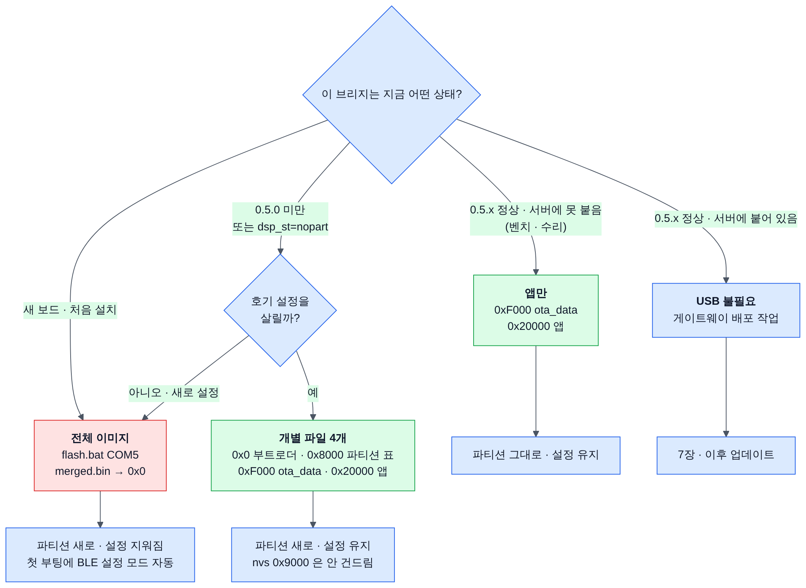

*보드 상태에 따라 굽는 범위가 다릅니다. 빨간 칸은 저장된 호기 설정을 지우고, 초록 칸은 남깁니다.*

| 방법 | 쓰는 경우 | 파티션 표 | 호기 설정 (nvs) | 절 |
|---|---|---|---|---|
| 전체 이미지 | 새 보드. 0.5.0 미만(또는 `nopart`)에서 올리며 다시 설정할 때 | 새로 씀 | **지워짐** | [3-1](#3-1-전체-이미지-새-보드) |
| 개별 파일 4개 | 0.5.0 미만(또는 `nopart`)에서 올리며 설정을 살릴 때 | 새로 씀 | 유지 | [3-2](#3-2-050-미만--05x-파티션-변경) |
| 앱만 | 이미 0.5.x 파티션인 보드를 USB 로 다시 구울 때 | 그대로 | 유지 | [3-3](#3-3-설정을-살려서-다시-굽기-05x-보드) |
| 굽지 않음 | 0.5.x 파티션이고 게이트웨이에 붙어 있음 | — | 유지 | [7장](#7-이후-업데이트-게이트웨이-배포-작업) |

시작 전에 시리얼 모니터(Arduino IDE, PuTTY 등)를 **닫습니다**. 포트를 잡고 있으면 굽기가 실패합니다.

### 3-1. 전체 이미지 (새 보드)

zip 을 푼 폴더에서 실행합니다.

```bat
:: Windows
flash.bat COM5
```

```bash
# Linux / macOS
chmod +x flash.sh
./flash.sh /dev/ttyUSB0
```

스크립트 없이 직접 실행할 때:

```bash
esptool --chip esp32s3 -p COM5 -b 921600 write_flash 0x0 agv_wifi_bridge_merged.bin
```

1. `Hash of data verified.` 가 나옵니다.
2. 보드가 자동으로 재부팅합니다.
3. `flash.bat` 은 끝에 `done. open a terminal at 115200 on the UART-side USB for the bridge> console.` 을 출력합니다.

> **주의 — 전체 이미지는 저장된 호기 설정을 지웁니다.**
> 전체 이미지는 nvs(설정 저장 영역, 0x9000)까지 덮어씁니다. 설정한 호기를 다시 구우면 처음 설치 상태가 됩니다.
> 부팅하면 무선 설정 모드(BLE)가 자동으로 열리고, [5장](#5-호기-설정)을 다시 해야 합니다.

완전히 지우고 새로 시작하려면 먼저 지운 뒤 전체 이미지를 굽습니다.

```bash
esptool --chip esp32s3 -p COM5 erase_flash
```

### 3-2. 0.5.0 미만 → 0.5.x (파티션 변경)

0.5.0 부터 플래시 배치(파티션 표)가 바뀌었습니다. 메인보드 이미지를 보관할 `dspfw` 384KB 를 만들고, 앱 슬롯을 줄였습니다.

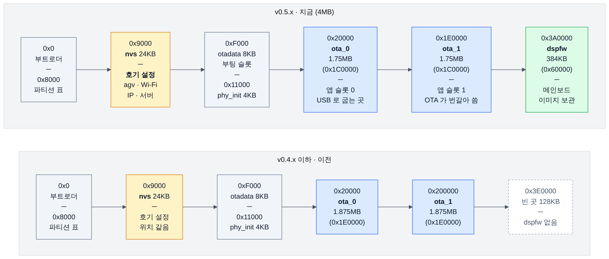

*위가 지금(0.5.x), 아래가 이전(0.4.x 이하) 배치입니다. 호기 설정이 있는 nvs 는 위치가 같습니다.*

| 파티션 | 0.2.x ~ 0.4.x | 0.5.x |
|---|---|---|
| `ota_0` | 0x20000, 1.875MB (0x1E0000) | 0x20000, **1.75MB (0x1C0000)** |
| `ota_1` | 0x200000, 1.875MB | **0x1E0000**, 1.75MB |
| `dspfw` | 없음 | **0x3A0000, 384KB (0x60000)** |
| `nvs` · `otadata` · `phy_init` | 0x9000 · 0xF000 · 0x11000 | 같음 |

**OTA 로는 파티션 표(0x8000)를 바꿀 수 없습니다.** OTA 는 앱 슬롯만 씁니다. 그래서 0.5.0 미만 보드는 호기마다 **USB 로 한 번** 다시 구워야 합니다.

방법은 둘 중 하나입니다.

**A. 전체 이미지** — 설정이 지워집니다. [3-1](#3-1-전체-이미지-새-보드) 대로 굽고 [5장](#5-호기-설정)을 다시 합니다.

**B. 개별 파일 4개** — 부트로더 · 파티션 표 · 부팅 슬롯 · 앱을 씁니다. nvs(0x9000)는 건드리지 않아 **설정이 유지됩니다**.

```bash
esptool --chip esp32s3 -p COM5 -b 921600 write_flash 0x0 bootloader.bin 0x8000 partition-table.bin 0xf000 ota_data_initial.bin 0x20000 agv_wifi_bridge.bin
```

같은 4개를 `flash_args` 로 써도 됩니다. esptool v5 기준이며, 오래된 esptool 에서 옵션 오류가 나면 위 명령을 씁니다.

```bash
esptool --chip esp32s3 -p COM5 -b 921600 write_flash @flash_args
```

굽고 나서 확인합니다.

1. 콘솔에서 `stat` 을 칩니다.
2. `dsp :` 줄의 `state=` 가 `nopart` 가 아니면 됩니다 (보통 `idle`).
3. 게이트웨이 **호기 현황** 의 메인보드 열에 `⚠ 파티션 없음` 이 없어야 합니다.

#### 구 파티션인 채 OTA 로 0.5.x 를 받은 경우

0.5.0 미만 보드에 게이트웨이나 BridgeTest 로 0.5.x 앱을 OTA 하면 앱은 올라갑니다. 브리지 중계 · 설정 · 브리지 OTA 는 정상입니다. **메인보드 OTA 만 안 됩니다.**

| 어디서 | 보이는 것 |
|---|---|
| 부팅 로그 | `E (...) dsp_ota: partition 'dspfw' not found - mainboard OTA disabled until this bridge is reflashed over USB with the new partition table` |
| 콘솔 `stat` · `dsp` | `dsp : ... state=nopart (USB reflash needed) ...` |
| heartbeat | `"dsp_st":"nopart"` |
| 게이트웨이 호기 현황 | 메인보드 열 `⚠ 파티션 없음` |
| 게이트웨이 메인보드 배포 작업 | `브리지에 dspfw 파티션이 없음 … USB 로 한 번 전체 굽기 필요` 로 실패 |
| 메인보드 OTA 명령 | `no_partition` 으로 거부 |

조치: 위 A 또는 B 로 USB 굽기.

위 표는 **0.5.1 기준**입니다. 0.5.0 은 다르게 보입니다.

- 부팅 로그에 `partition 'dspfw' not found (partitions.csv)` 와 `dsp ota init failed: ESP_ERR_NOT_FOUND` 가 나옵니다.
- `dsp_st` 는 `nopart` 가 아니라 `idle` 로 나옵니다. 게이트웨이도 경고를 띄우지 못합니다.
- 메인보드 OTA 명령을 받으면 브리지가 재부팅합니다.
- 0.5.0 이 OTA 로 올라간 보드인지 모르면 B 로 한 번 굽습니다. 설정은 유지됩니다.

### 3-3. 설정을 살려서 다시 굽기 (0.5.x 보드)

이미 0.5.x 파티션인 보드를 USB 로 다시 구울 때는 **앱과 부팅 슬롯만** 굽습니다.

```bash
esptool --chip esp32s3 -p COM5 -b 921600 write_flash 0xf000 ota_data_initial.bin 0x20000 agv_wifi_bridge.bin
```

- 파티션 표를 쓰지 않으므로 **0.5.0 미만 보드에는 쓰지 않습니다**. `nopart` 상태가 그대로 남습니다.
- 부팅 슬롯이 `ota_0` 으로 돌아갑니다.

### 연결이 안 될 때 (`Failed to connect to ESP32-S3`)

1. 시리얼 모니터가 포트를 잡고 있지 않은지 확인합니다.
2. 보드의 **BOOT 버튼을 누른 채 RESET 을 눌렀다 떼고**, BOOT 를 뗀 뒤 다시 실행합니다 (다운로드 모드 수동 진입).
3. 케이블이 길거나 불안정하면 속도를 낮춥니다: `-b 460800` 또는 `-b 115200`.

---

## 4. 부팅 확인

1. 터미널을 **115200 bps** 로 엽니다. PuTTY, Tera Term, Arduino IDE 시리얼 모니터, 또는 `python -m serial.tools.miniterm COM5 115200`.
2. RESET 을 누릅니다.
3. 처음 굽은 보드는 아래와 비슷한 로그가 나옵니다.

```
I (...) cfg: no saved config, using defaults
agv=1 ssid="AGV_TEST" pass=(8 chars)
ip=dhcp mask=255.255.255.0 gw=0.0.0.0
server=192.168.0.10:50000 local_port=50000
rfid_dst=255.255.255.255:50001
main_baud=115200 rfid_baud=9600 hb_ms=1000
state=default
I (...) net: connecting to "AGV_TEST" ...
W (...) setup: setup mode on - "AGVBR-01-A1B2"
W (...) setup_ble: advertising as "AGVBR-01-A1B2"
bridge>
```

- 가운데 6줄은 지금 설정입니다. 처음에는 빌드 기본값(`state=default`)입니다.
- 저장된 설정이 없으므로 **무선 설정 모드(BLE)가 자동으로 열립니다.**
- `AGVBR-01-A1B2` 의 `01` 은 호기 번호, `A1B2` 는 Wi-Fi MAC 끝 4자리입니다.
- Enter 를 치면 `bridge>` 프롬프트가 나옵니다. `help` 로 명령 목록을 봅니다.

펌웨어 버전은 `ota` 명령으로 봅니다.

```
bridge> ota
fw=0.5.1 part=ota_0 state=valid
```

---

## 5. 호기 설정

### 방법 고르기

| 방법 | 쓰는 경우 | 연결 | 저장의 성격 |
|---|---|---|---|
| **A. 휴대폰 BLE** (현장 권장) | 처음 설치, Wi-Fi 설정이 틀려 서버에 못 붙을 때 | 블루투스(BLE) 터미널 앱 | 즉시 확정 |
| B. USB 콘솔 | 벤치, 처음 굽을 때 | USB 케이블 | 즉시 확정 |
| C. 서버 원격 | 이미 게이트웨이에 붙은 호기의 IP · 서버 주소 등 변경 | 기존 Wi-Fi | **확인 대기** — 180초 안에 서버 패킷 필요 |
| D. 설정 AP + 웹 페이지 | 직접 빌드에서 켰을 때만 (Releases zip 에는 없음) | 브리지가 띄운 Wi-Fi AP | 즉시 확정 |

- 네 방법 모두 같은 키를 씁니다.
- `set` 은 편집 사본만 바꿉니다. **`save` 후 재부팅해야 적용됩니다.**

### 설정 키

| 키 | 뜻 | 빌드 기본값 | 입력 규칙 |
|---|---|---|---|
| `agv` | 호기 번호 | `1` | 1~99 |
| `ssid` | Wi-Fi 이름 | `AGV_TEST` | 1~32자. 공백 가능 (아래 참고) |
| `pass` | Wi-Fi 비밀번호 | `agv12345` | 8~64자. `-` = 비밀번호 없음(오픈 AP) |
| `ip` | 고정 IP | 빈 값 (DHCP) | `dhcp` = DHCP. 현장은 고정 IP 권장 |
| `mask` | 서브넷 마스크 | `255.255.255.0` | 0.0.0.0 불가 |
| `gw` | 기본 게이트웨이 (공유기) | `0.0.0.0` | |
| `server` | **게이트웨이 PC IP** | `192.168.0.10` | 0.0.0.0 불가 |
| `server_port` | 서버 UDP 포트 | `50000` | 게이트웨이 `Gateway.UdpPort`(기본 50000)와 같게 |
| `local_port` | 브리지 수신 UDP 포트 | `50000` | |
| `rfid_dst` | RFID 송신 주소 | `255.255.255.255` (브로드캐스트) | `off` = 네트워크로 안 보냄 |
| `rfid_port` | RFID 송신 포트 | `50001` | |
| `main_baud` | 메인보드(J4) 보드레이트 | `115200` | 1200~1000000. **메인보드 OTA 를 쓰면 115200 유지** — 부트로더는 115200 고정이고 브리지는 굽는 동안 속도를 바꾸지 않음 |
| `rfid_baud` | RFID 리더 보드레이트 | `9600` | 리더 실제 값에 맞춤 |
| `hb_ms` | 상태 보고(heartbeat) 주기 ms | `1000` | 0 = 끔, 또는 100~60000 |

- IP 는 `192.168.10.107` 같은 10진 표기만 받습니다.
- 공백이 있는 SSID: BLE · 서버 원격은 줄 끝까지 값으로 받습니다 (`set ssid AGV WIFI 2F`). USB 콘솔은 큰따옴표로 감쌉니다 (`set ssid "AGV WIFI 2F"`).
- `hb_ms` 는 기본값 그대로 둡니다. 게이트웨이는 패킷이 5초 넘게 없으면 오프라인으로 봅니다.

#### 서버 IP 확인

게이트웨이 화면 메뉴 **설정** → **서버** 칸의 `HTTP` 줄에 "이 PC 주소" 가 나옵니다. 이 IP 를 `server` 에 넣습니다.

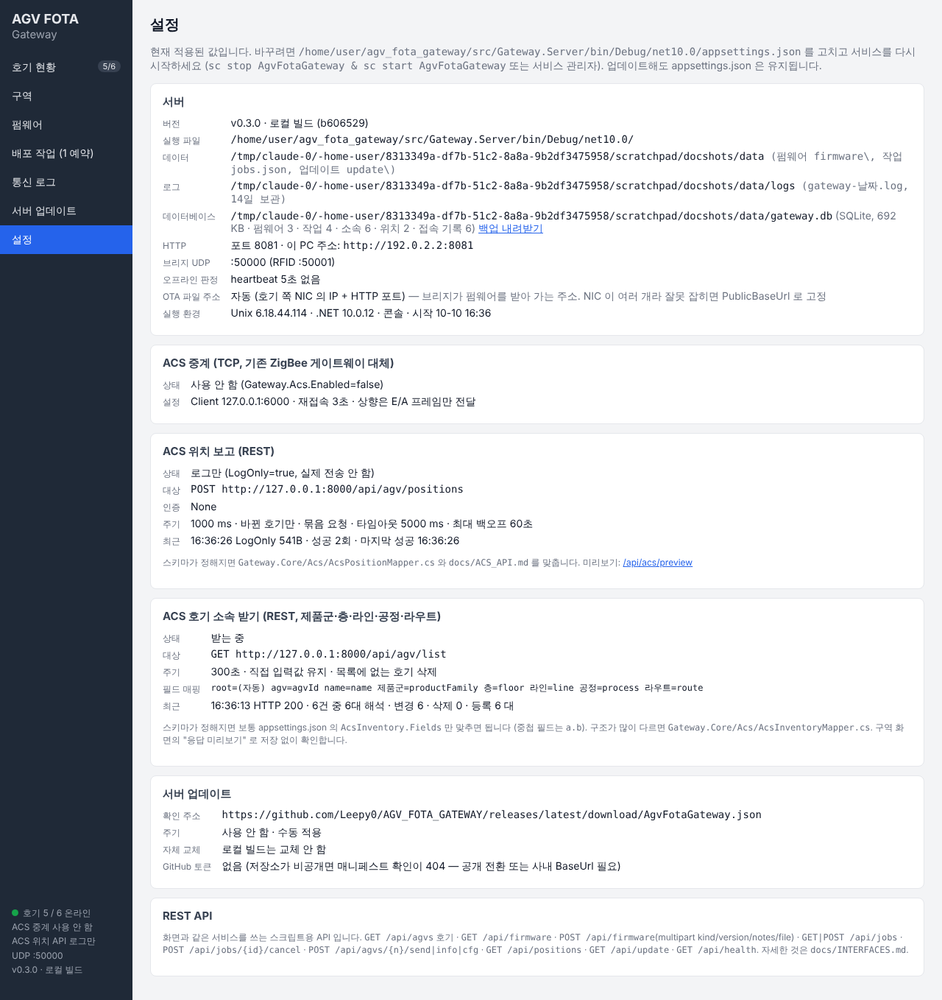

*`HTTP` 줄에 포트와 이 PC 의 IPv4 주소가 보입니다. 시연 환경이라 포트가 8081 이고, 설치 기본값은 8080 입니다.*

- PC 에 랜카드가 여러 개면 브리지 Wi-Fi 망 쪽 주소를 고릅니다.
- 브리지는 **`server` IP 에서 온 패킷만** 받습니다. 게이트웨이 PC 는 고정 IP 로 둡니다.

### 설정 모드 (BLE) 가 열리고 닫히는 조건

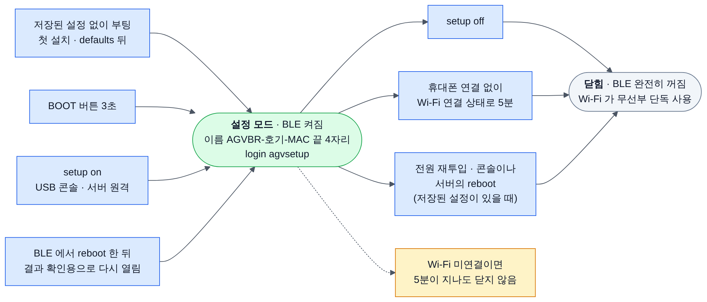

*BLE 는 설정 모드 동안만 켜집니다. 닫히면 블루투스를 완전히 끄고 Wi-Fi 가 무선부를 혼자 씁니다.*

| | 조건 |
|---|---|
| 열림 | 저장된 설정 없이 부팅(처음 설치, `defaults` 뒤) · **BOOT 버튼 3초** · 콘솔이나 서버의 `setup on` · BLE 에서 `reboot` 한 직후 |
| 닫힘 | `setup off` · 휴대폰 연결 없이 Wi-Fi 연결 상태로 5분 · 전원 재투입이나 콘솔 · 서버의 `reboot` (저장된 설정이 있을 때) |
| 안 닫힘 | Wi-Fi 에 못 붙은 동안은 유일한 접근 경로라 5분이 지나도 닫지 않음 |

상태는 콘솔 `setup` 으로 봅니다.

```
bridge> setup
setup: on name=AGVBR-01-A1B2 ble=advertising
```

### 5-1. 휴대폰 BLE (현장 권장)

회사 Wi-Fi 보안과 관계없이 BLE 로 접속합니다. 그동안에도 브리지 중계는 계속 동작합니다.

| 휴대폰 | 앱 (무료) | 연결 방법 |
|---|---|---|
| Android | **Serial Bluetooth Terminal** (Kai Morich) | 메뉴(☰) → Devices → **Bluetooth LE** 탭 → SCAN → `AGVBR-…` 선택 |
| iPhone | **Bluefruit Connect** (Adafruit) 또는 nRF Toolbox | 목록에서 `AGVBR-…` → Connect → **UART** |

> 휴대폰 설정 화면의 블루투스 목록에서 페어링하지 않습니다. 반드시 **앱 안에서 스캔해 연결**합니다. 처음 실행할 때 블루투스 · 위치(근처 기기) 권한을 허용합니다.

1. 설정 모드를 엽니다. 처음 설치한 보드는 이미 열려 있습니다. 아니면 **BOOT 버튼을 3초** 누릅니다.
2. 앱에서 `AGVBR-<호기 2자리>-<MAC 끝 4자리>` 에 연결합니다. 처음 설치한 보드는 호기 번호가 기본값이라 `AGVBR-01-…` 입니다.
3. 안내 문구가 나옵니다.
   ```
   AGV Wi-Fi Bridge AGVBR-01-A1B2 (fw 0.5.1)
   login <password>
   ```
4. `login agvsetup` 을 보냅니다. `ok - type help` 가 오면 됩니다.
5. 아래를 한 줄씩 보냅니다. 줄마다 `ok agv - 'save' then 'reboot' to apply` 처럼 답이 옵니다.
   ```
   set agv 7
   set ssid AGV_WIFI
   set pass mypassword
   set ip 192.168.10.107
   set mask 255.255.255.0
   set gw 192.168.10.1
   set server 192.168.10.10
   ```
6. `cfg` 로 확인합니다. 끝에 `* differs from running config - 'save' then 'reboot' to apply` 가 보이면 정상입니다.
7. `save` → `saved - 'reboot' to apply` 가 옵니다.
8. `reboot` → `rebooting` 후 연결이 끊깁니다.
9. 재부팅 뒤 설정 모드가 **다시 열립니다.** 이름이 새 호기 번호로 바뀝니다 (`AGVBR-07-A1B2`). 다시 스캔해 연결합니다.
10. `login agvsetup` → `stat` 을 보냅니다. 아래처럼 나오면 성공입니다.
    ```
    fw=0.5.1 part=ota_0 ota=valid cfg=saved
    wifi: UP ip=192.168.10.107 rssi=-55 ch=6 bssid=…
    ```
11. `setup off` 로 닫거나 연결을 끊습니다. 끊으면 Wi-Fi 연결 상태에서 5분 뒤 자동으로 닫힙니다.

알아 둘 것:

- 비밀번호 기본값은 `agvsetup` 입니다. 다시 연결할 때마다 `login` 이 필요합니다.
- 틀리면 1초 뒤 `wrong password` 가 옵니다. 로그인 전 명령에는 `login required: login <password>` 가 옵니다.
- 한 번에 휴대폰 **한 대만** 연결됩니다.
- 앱의 줄바꿈 설정은 상관없습니다. CR · LF · CR+LF 모두 받고, 줄바꿈이 없으면 마지막 입력 0.3초 뒤 한 줄로 처리합니다.
- BLE 에서 쓸 수 있는 명령: `cfg` · `set` · `save` · `reboot` · `stat` · `setup on|off` · `dsp` · `defaults` · `help`.
- BLE 저장은 현장 저장이라 즉시 확정됩니다. 대기 중인 원격 설정 복구(5-3)도 취소합니다.
- BLE 가 켜져 있는 동안은 Wi-Fi 와 무선부(2.4GHz)를 나눠 써서 지연이 늘 수 있습니다. 운용 중인 호기는 **AGV 를 세운 상태**에서 설정합니다.
- ESP32-S3 는 BLE 만 지원합니다. 클래식 블루투스(SPP) 전용 앱에서는 보이지 않습니다.

### 5-2. USB 콘솔

[4장](#4-부팅-확인)처럼 115200 bps 터미널을 열고 입력합니다.

```
bridge> set agv 7
bridge> set ssid AGV_WIFI
bridge> set pass mypassword
bridge> set ip 192.168.10.107
bridge> set mask 255.255.255.0
bridge> set gw 192.168.10.1
bridge> set server 192.168.10.10
bridge> set rfid_baud 9600
bridge> cfg
bridge> save
bridge> reboot
```

- `set` 은 `ok - 'save' then 'reboot' to apply`, `save` 는 `saved` 로 답합니다.
- 인자 없이 `set` 만 치면 키 목록이 나옵니다.
- 콘솔에서 `reboot` 하면 설정 모드는 다시 열리지 않습니다.
- 재부팅 뒤 `stat` 의 `wifi: UP ip=…` 로 확인합니다.

콘솔 명령 전체는 [10-2](#10-2-명령-요약)에 있습니다.

### 5-3. 서버 원격 (게이트웨이)

이미 게이트웨이 **호기 현황** 에 보이는 호기만 됩니다. 게이트웨이가 그 호기의 주소를 heartbeat 로 알아야 보낼 수 있습니다.

1. 게이트웨이 메뉴 **통신 로그** 를 엽니다.
2. 아래 **수동 전송** 칸의 **호기** 에 번호를 적습니다.
3. **설정 명령** 칸에 `cfg` 를 적고 **CFG_CMD 전송** 을 누릅니다.
4. 위 로그에 `[07] CFG> agv=7 ssid="…" …` 처럼 답이 나옵니다. 비밀번호는 길이만 보입니다.
5. `set ip 192.168.10.117` → **CFG_CMD 전송**. 답: `ok ip - 'save' then 'reboot' to apply`.
6. `save` → 답: `saved - 'reboot' to apply (reverts if no server contact after reboot)`.
7. `reboot` → 답: `rebooting`. 브리지가 재부팅합니다.
8. **180초 안에** **호기 현황** → 그 호기 행 → **PING** 을 누릅니다.
9. 호기 현황의 `cfg` 열이 `trial` 에서 `saved` 로 바뀌면 확정입니다.

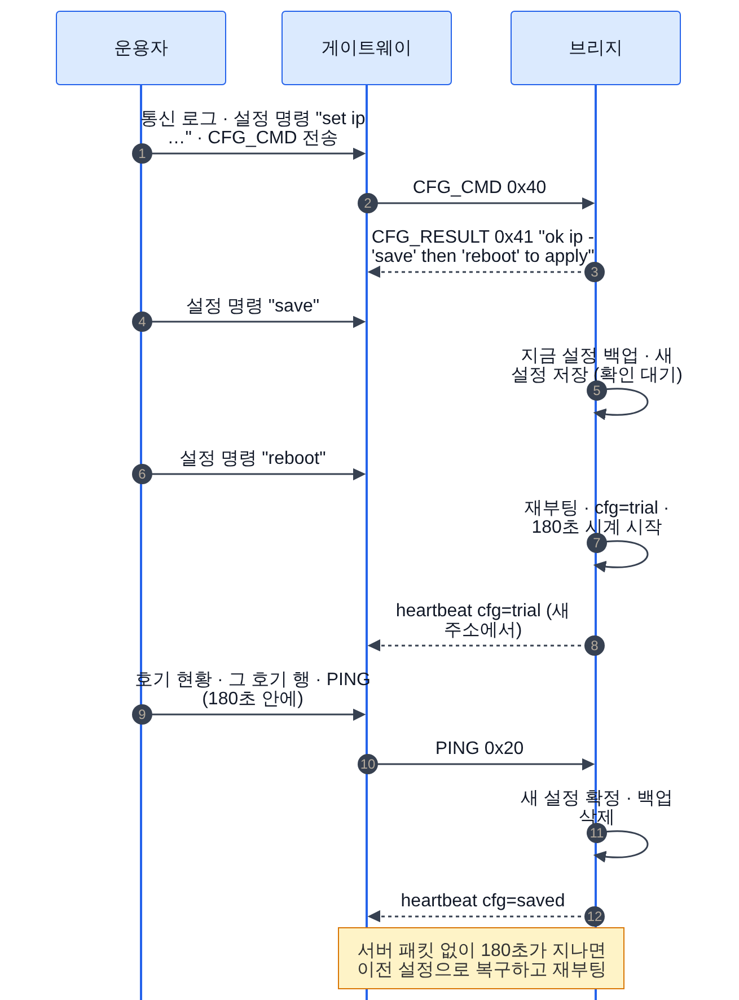

*원격 저장은 확인 대기 상태입니다. 재부팅 뒤 서버 패킷을 받아야 확정되고, 못 받으면 저장 직전 설정으로 돌아갑니다.*

> **게이트웨이는 브리지에 주기적으로 패킷을 보내지 않습니다.** 원격 설정 뒤에는 직접 **PING** 을 누릅니다.
> ACS 중계로 하향 프레임이 오가는 중이면 그것으로도 확정됩니다.

- 목적: SSID · IP · 서버 주소를 잘못 넣어도 호기가 끊긴 채로 남지 않게 합니다.
- `server` 를 바꿨다면 **새 게이트웨이**에서 180초 안에 PING 을 보내야 합니다.
- 원격 명령: `cfg` · `set` · `save` · `reboot` · `stat` · `setup on|off` · `dsp` · `help`. `defaults` 는 원격에서 안 됩니다.
- 인증은 서버 IP 필터와 호기 번호 일치뿐입니다. 사내망 전제입니다.
- 벤치에서는 BridgeTest 로도 같습니다: `cfg 7 set ip 192.168.10.117` → `cfg 7 save` → `cfg 7 reboot`.

### 5-4. 설정 AP + 웹 페이지 (선택, 기본 꺼짐)

**Releases zip 의 빌드에는 꺼져 있습니다.** 쓰려면 menuconfig 에서 켜고 직접 빌드합니다.

```
idf.py menuconfig
  → AGV Wi-Fi Bridge → Wireless setup (phone BLE / SoftAP) → Wi-Fi SoftAP + web page setup
```

> 사내 무선 보안(WIPS)이 비인가 AP 를 차단하거나 경보를 내는 현장에서는 쓰지 않습니다.

1. 설정 모드를 엽니다 (BLE 와 같은 조건). BLE 와 AP 가 함께 뜹니다.
2. 휴대폰 Wi-Fi 목록에서 `AGVBR-…` (BLE 이름과 같음)에 접속합니다. 비밀번호 기본값은 `agvsetup` 입니다.
3. 브라우저로 `http://192.168.4.1` 을 엽니다. "AGV Wi-Fi Bridge 설정" 페이지가 나옵니다.
4. 값을 고치고 **저장 후 재부팅** 을 누릅니다.

- 비밀번호 칸은 비우면 기존 값을 유지합니다. `-` 를 넣으면 비밀번호 없음입니다.
- 잘못된 값이 하나라도 있으면 아무것도 저장하지 않고 `잘못된 값: …` 을 보여 줍니다.
- 저장하면 재부팅하고 AP 는 닫힙니다. BLE 와 달리 다시 열리지 않습니다.
- 이 페이지는 설정 AP 로 들어온 요청만 받습니다. 공장망 IP 로 열면 거부됩니다.
- AP 에는 휴대폰 2대까지 붙습니다.
- 실제 AP 주소는 부팅 로그 `setup_ap: setup AP "…" open - http://…` 에 나옵니다.

---

## 6. 게이트웨이 연결 확인

게이트웨이 설치는 [DEPLOY.md](https://github.com/Leepy0/AGV_FOTA_GATEWAY/blob/main/docs/DEPLOY.md) 2장을 따릅니다.
`install-service.bat` 이 PC 방화벽에 TCP 8080, UDP 50000 · 50001 허용 규칙을 넣습니다.

### 6-1. 호기 현황에 나타나는지

1. 게이트웨이 화면 메뉴 **호기 현황** 을 엽니다.
2. 브리지가 heartbeat 를 보내면(기본 1초마다) 한 줄이 생깁니다.

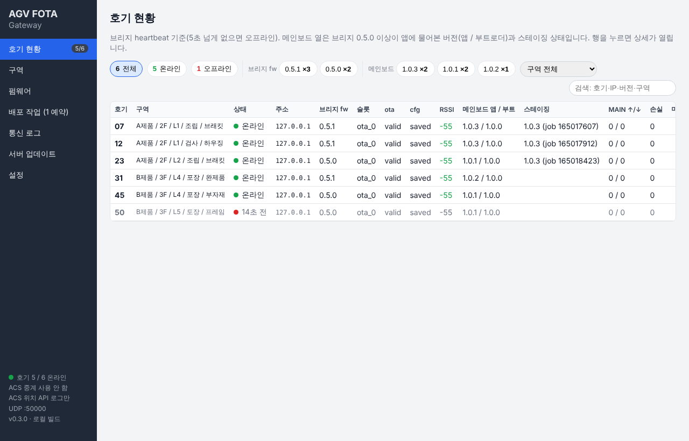

*가짜 브리지 6대 시연 화면입니다. 실제로는 주소 열에 각 브리지 IP 가 나옵니다. 50번은 heartbeat 가 끊겨 "14초 전" 으로 보입니다.*

| 열 | 정상 값 | 다른 값일 때 |
|---|---|---|
| 상태 | `온라인` | `N초 전` = 5초 넘게 heartbeat 없음 → [9장](#9-문제-해결) |
| 주소 | 브리지에 넣은 `ip` | 다르면 DHCP 로 받은 주소. 고정 IP 설정 확인 |
| 브리지 fw | `0.5.1` | 0.5.0 미만이면 [3-2](#3-2-050-미만--05x-파티션-변경) |
| 슬롯 | `ota_0` / `ota_1` | 지금 실행 중인 앱 슬롯 |
| ota | `valid` | `pending` = OTA 뒤 미확정 → **PING** |
| cfg | `saved` | `default` = 저장된 설정 없음. `trial` = 원격 설정 확정 대기 → 180초 안에 **PING**. `(AP)` = 설정 모드 켜짐 |
| RSSI | -60 이상 좋음, -70 까지 보통 | -70 ~ -80 약함, -80 미만 매우 약함 → AP 위치 확인 |
| 메인보드 앱 / 부트 | `1.0.3 / 1.0.0` 등 | `-` = 브리지 0.5.0 미만. `⚠ 파티션 없음` = USB 굽기 필요. `? / …` = 메인보드 앱이 버전 응답을 안 함 |

### 6-2. 호기 상세

행을 누르면 상세가 열립니다.

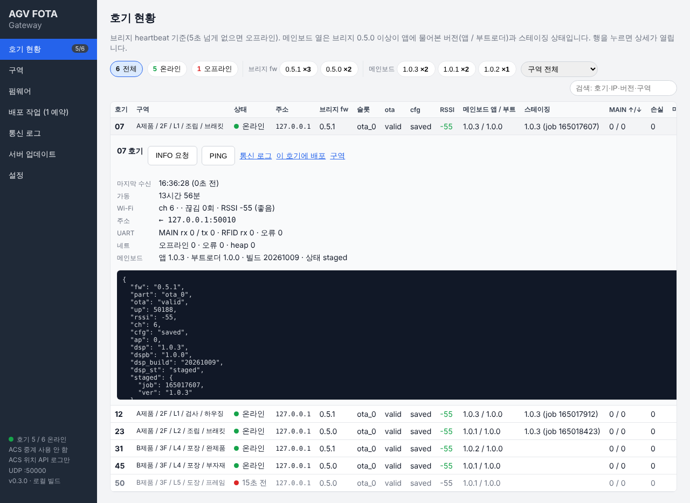

*07호기 상세. 위 버튼으로 INFO 요청 · PING 을 보냅니다. 아래 검은 칸은 마지막 heartbeat 원문입니다.*

1. **PING** 을 누릅니다. 브리지 콘솔 `stat` 의 `net :` 줄 `rx=` 가 늘면 하향도 정상입니다.
2. **INFO 요청** 을 누르면 브리지가 상태를 바로 다시 보냅니다.
3. heartbeat 원문에서 `"fw"`, `"cfg"`, `"dsp_st"` 를 확인합니다.

### 6-3. 브리지 쪽에서 확인

| 확인 | 방법 | 정상 |
|---|---|---|
| Wi-Fi | 콘솔 `stat` | `wifi: UP ip=192.168.10.107 rssi=-40~-70` |
| 송신 | `stat` 의 `net :` 줄 | `tx=` 증가, `tx_err=0` |
| 하향 수신 | 게이트웨이 **PING** 후 `stat` | `rx=` 증가, `rx_foreign` 은 늘지 않음 |
| 메인보드 프레임 | 게이트웨이 호기 현황 `MAIN ↑/↓` | AGV 메인보드가 붙어 있으면 증가 |

배선은 [README](../README.md) 의 **기본 핀** 표를 따릅니다 (3V3 / GND / GPIO17 · 18 메인보드, GPIO4 · 5 RFID). AGV 장착 시에는 BOB-11189 대신 절연형(TD301D232H ×2)을 씁니다.

> 게이트웨이 없이 벤치에서 볼 때는 `tools/BridgeTest.cs` 를 씁니다 (`dotnet run BridgeTest.cs`, 명령 `list` · `ping 7 100` · `hb`).
> BridgeTest 와 게이트웨이는 같은 PC 에서 함께 띄우지 않습니다. 둘 다 UDP 50000 을 씁니다.

---

## 7. 이후 업데이트 (게이트웨이 배포 작업)

0.5.x 파티션으로 구운 뒤로는 USB 없이 게이트웨이에서 무선으로 올립니다. **호기 설정은 유지됩니다.**

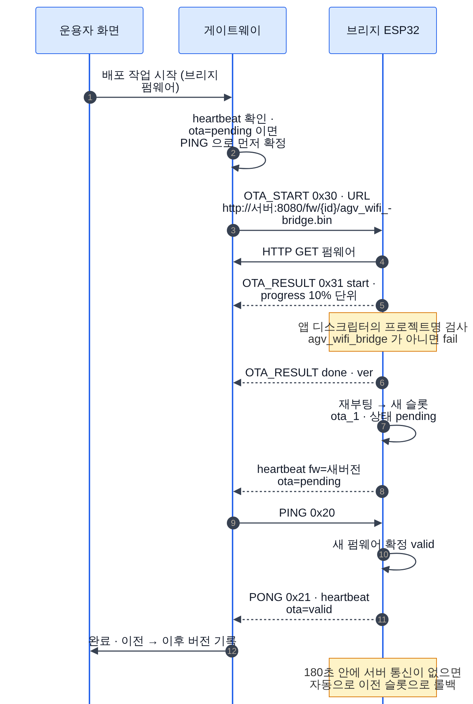

*게이트웨이 배포 작업이 브리지를 업데이트하는 순서입니다. 실제 progress 보고는 10% 단위입니다.*

### 7-1. 펌웨어 올리기

1. 게이트웨이 메뉴 **펌웨어** 를 엽니다.
2. **종류** 에서 `브리지 ESP32-S3 (agv_wifi_bridge.bin)` 을 고릅니다.
3. zip 안의 **`agv_wifi_bridge.bin`** 을 고릅니다. `agv_wifi_bridge_merged.bin` 은 거부됩니다.
4. **업로드** 를 누릅니다.

### 7-2. 배포 작업

1. 메뉴 **배포 작업** 을 엽니다. 위쪽 **새 작업** 칸에서 고릅니다.
2. **펌웨어** 에서 `[브리지 ESP] 0.5.x — agv_wifi_bridge (…)` 를 고릅니다.
3. 대상 호기를 고릅니다. **업데이트 필요한 호기 선택** 을 누르면 버전이 다른 온라인 호기만 골라집니다.
4. **실행 시각** 이 `지금 바로` 인지 보고 **지금 시작 (N대)** 를 누릅니다.

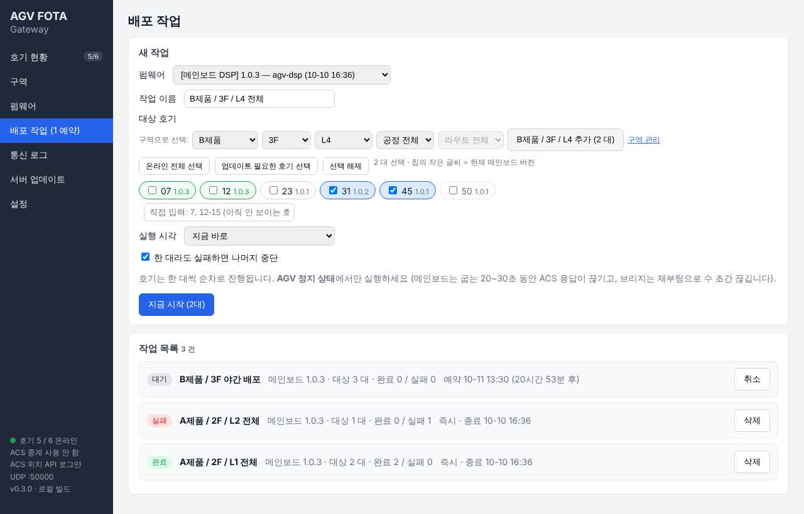

*새 작업 화면 (메인보드 펌웨어 예시). 브리지 펌웨어도 같은 화면에서 고릅니다.*

작업은 호기마다 아래를 자동으로 합니다.

1. `OTA_START` 로 펌웨어 주소 `http://<게이트웨이 PC>:8080/fw/…/agv_wifi_bridge.bin` 을 보냅니다.
2. 브리지가 HTTP 로 받아 빈 슬롯에 씁니다. `start` → `progress` → `done`.
3. 브리지가 재부팅합니다. 새 펌웨어는 `ota=pending` 입니다.
4. 게이트웨이가 PING 을 보내 확정합니다 (`ota=valid`).
5. heartbeat 의 `fw` 가 새 버전인지 확인하고 완료합니다.

### 7-3. 지킬 것

- **AGV 를 세운 상태에서** 합니다. 재부팅으로 수 초간 통신이 끊기고, 플래시에 쓰는 동안 중계가 늦어질 수 있습니다.
- 작업은 호기를 **한 대씩** 순서대로 진행합니다.
- 새 펌웨어가 **180초 안에** 서버 패킷을 못 받으면 이전 슬롯으로 자동 롤백합니다.
- 프로젝트 이름이 `agv_wifi_bridge` 가 아닌 이미지는 브리지가 거부합니다.
- 브리지가 펌웨어를 받으려면 게이트웨이 PC 의 **TCP 8080** 이 열려 있어야 합니다.
- 0.5.0 미만 호기는 먼저 [3-2](#3-2-050-미만--05x-파티션-변경)대로 USB 로 굽습니다. OTA 로 올리면 `nopart` 상태가 됩니다.
- 여러 대 · 구역 단위 배포, 예약, 실패 처리는 [DEPLOY.md](https://github.com/Leepy0/AGV_FOTA_GATEWAY/blob/main/docs/DEPLOY.md) 6장을 봅니다.

> 벤치에서 게이트웨이 없이 올릴 때: BridgeTest `ota 7 agv_wifi_bridge.bin` (PC 가 HTTP 8070 으로 파일 제공). 콘솔 직접: `ota http://…/agv_wifi_bridge.bin`.

---

## 8. 메인보드 첫 설치 (메인보드 OTA 를 쓸 호기만)

메인보드(TMS320F2808) 펌웨어도 게이트웨이에서 무선으로 올리려면, 호기마다 **유선으로 한 번** 준비해야 합니다.
메인보드에 상주 부트로더를 넣고, 앱을 부트로더 뒤에 오도록 다시 링크합니다.

> **메인보드 OTA 는 실기 검증 전입니다.** 처음에는 벤치나 한 대로 먼저 시험합니다.
> 이전 방식(DSP_OTA 저장소)은 보관됨 · 이 방식(B안)으로 대체되었습니다.

이 절은 **순서와 확인 방법**만 다룹니다. CCS 프로젝트 · Flash API · 링커 cmd · 앱 수정은 [dsp/README.md](../dsp/README.md), 설계와 규격은 [DSP_OTA_DESIGN.md](DSP_OTA_DESIGN.md) 를 봅니다.

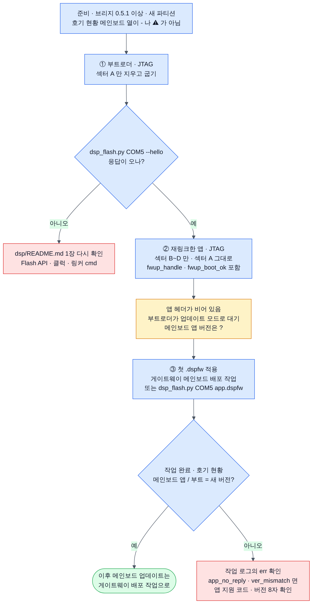

*부트로더 → 재링크한 앱 → 첫 .dspfw 적용 순서입니다. ② 와 ③ 사이에는 메인보드 앱이 돌지 않습니다.*

### 8-1. 준비

| 준비물 | 내용 |
|---|---|
| 브리지 | **0.5.1** (이 저장소 기준), 새 파티션. 6장에서 메인보드 열이 `-` 나 `⚠ 파티션 없음` 이 아님 |
| 개발 환경 | CCS 9.1, 컴파일러 18.12.x LTS, JTAG 에뮬레이터 |
| Flash API | TI SPRC193 (F280x Flash API V3.02) |
| 메인보드 앱 | [dsp/README.md](../dsp/README.md) 2장대로 수정 · 재링크한 프로젝트 |
| `.dspfw` | 앱 빌드 결과를 `tools/dsp_pack.py` 로 만든 이미지. 버전은 **8자 이하** (예: `1.2.3`) |
| (선택) PC RS232 | 벤치 확인용. 브리지 대신 메인보드 J4 에 연결, `pip install pyserial` |

메인보드 플래시는 아래처럼 나뉩니다. 부트로더가 있는 섹터 A 는 OTA 로 지우지 않습니다.

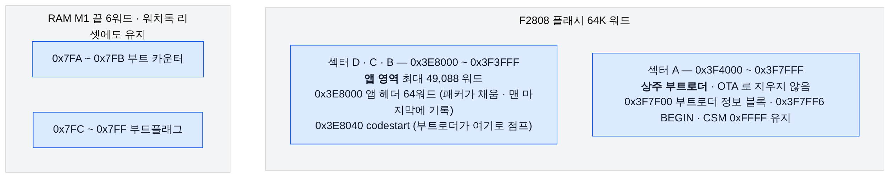

*섹터 A 는 부트로더, 섹터 B~D 는 앱입니다. RAM M1 끝 6워드는 부트 카운터와 부트플래그라 앱 링커에서 뺍니다.*

### 8-2. 순서

**① 부트로더 굽기 (JTAG)** — [dsp/README.md](../dsp/README.md) 1장.

1. 부트로더 프로젝트를 빌드합니다.
2. JTAG 으로 굽습니다. CCS 플래시 설정에서 **지울 섹터는 A 만** 고릅니다.
3. 확인 (PC RS232 가 있을 때): 메인보드 J4 에 PC 를 연결하고 실행합니다.
   ```bash
   python tools/dsp_flash.py COM5 --hello
   ```
   `boot_ver` 에 부트로더 버전(`1.0.0`)이, `app_valid` 에 `False` 가 나오면 정상입니다. 앱이 아직 없어 부트로더가 업데이트 모드로 기다리는 중입니다.

**② 재링크한 앱 굽기 (JTAG)** — [dsp/README.md](../dsp/README.md) 2장.

1. 링커 cmd 를 `dsp/app/F2808_app_example.cmd` 처럼 바꿉니다 (앱 헤더 0x3E8000, 시작 0x3E8040, RAMM1 길이 0x3FA).
2. `app_fwupdate.c/.h` 를 넣고 J4 수신 처리에 `fwup_handle()` 을 끼웁니다.
3. 초기화가 끝나 메인 루프에 들어갈 때 **`fwup_boot_ok()` 를 한 번** 부릅니다 (아래 8-3).
4. JTAG 으로 굽습니다. **섹터 B~D 만** 지우고, 섹터 A 는 그대로 둡니다.

> 이 상태에서는 **메인보드 앱이 돌지 않습니다.** 앱 헤더가 비어 있어 부트로더가 앱을 무효로 보고 기다립니다. ③ 까지 바로 이어서 합니다.
> 게이트웨이 호기 현황의 **메인보드 앱 / 부트** 열은 `? / ?` 로 보입니다. 앱이 없어 버전 응답이 없기 때문입니다.

**③ 첫 .dspfw 적용** — 앱 헤더를 채워 앱을 살립니다. 둘 중 하나로 합니다.

*방법 A. 게이트웨이 배포 작업 (현장)*

1. 브리지를 메인보드 J4 에 연결하고 게이트웨이 호기 현황에 온라인인지 봅니다.
2. 메뉴 **펌웨어** → 종류 `메인보드 DSP (TMS320F2808, .dspfw)` → `.dspfw` 업로드.
3. **배포 작업** → **새 작업** 칸에서 `[메인보드 DSP] …` 펌웨어와 그 호기를 고르고 **지금 시작** 을 누릅니다.
4. 브리지는 앱에서 응답이 없으면 바로 부트로더와 통신합니다. 지우기 → 쓰기 → 검증 → 리셋 → 버전 조회 순서로 진행합니다.

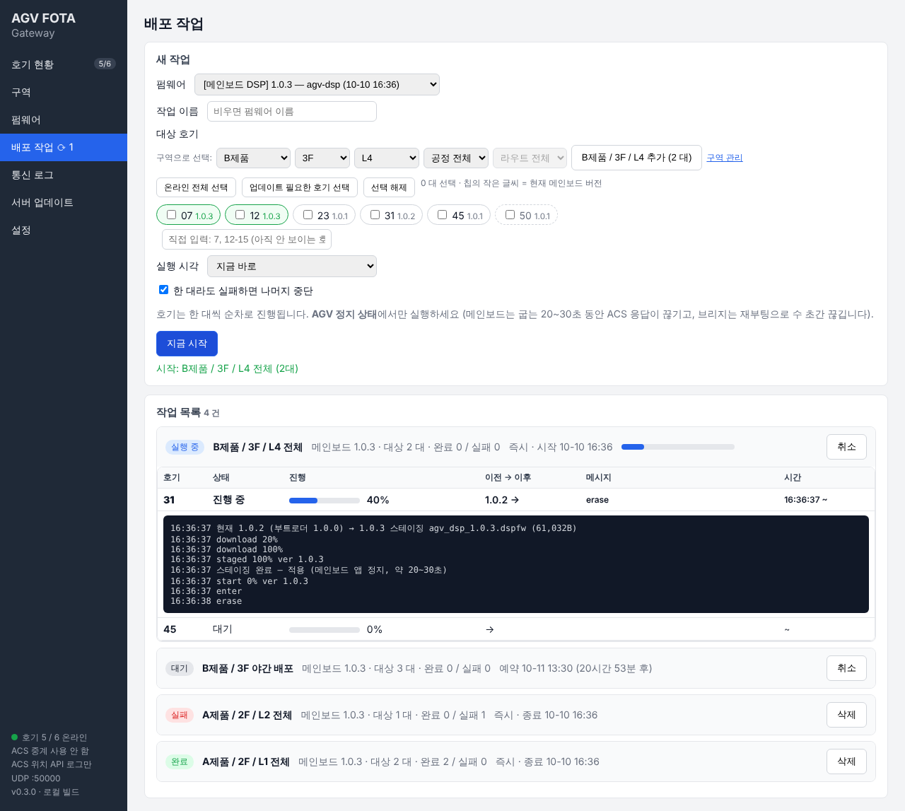

*메인보드 작업이 진행 중인 화면(40%, erase). 행 아래 검은 칸에 단계별 로그가 쌓입니다.*

*방법 B. PC 에서 직접 (벤치)*

```bash
python tools/dsp_flash.py COM5 app_1.2.3.dspfw
```

`verify ok … reset → app` 이 나오면 끝입니다.

벤치에서 브리지를 거쳐 하려면 게이트웨이 대신 BridgeTest 를 씁니다: `dspota 7 stage app_1.2.3.dspfw apply`.

### 8-3. `fwup_boot_ok()` 가 꼭 필요한 이유


*부트로더는 앱으로 점프할 때마다 부트 카운터를 올립니다. 앱이 `fwup_boot_ok()` 로 0 으로 돌려야 다음 리셋에도 앱이 뜹니다.*

- `fwup_boot_ok()` 를 부르지 않으면 리셋(워치독 등)할 때마다 카운터가 쌓입니다. 정상 동작하는 앱이라도 같습니다. 카운터는 RAM 에 있어 전원을 껐다 켜면 0 이 됩니다.
- 앱으로 3번 점프한 뒤 다시 리셋되면 (카운터 3 초과) 부트로더는 "기동 불능 앱" 으로 보고 업데이트 모드에 머뭅니다.
- 그동안 메인보드 앱이 돌지 않아 **AGV 가 섭니다.**
- 업데이트 모드는 유효한 부트로더 패킷 없이 10분이 지나야 앱으로 돌아갑니다. 바로 살리려면 새 이미지를 다시 적용합니다.
- 그래서 앱은 메인 루프 진입 시 `fwup_boot_ok()` 를 **반드시 한 번** 부릅니다.

### 8-4. 확인

| 확인 | 방법 | 정상 |
|---|---|---|
| 작업 결과 | 게이트웨이 **배포 작업** 목록 | `완료`, 이전 → 이후 `? → 1.2.3` |
| 메인보드 버전 | 호기 현황 **메인보드 앱 / 부트** | `1.2.3 / 1.0.0` |
| 브리지에서 | 콘솔 `dsp` | `dsp : app=1.2.3 boot=1.0.0 build=… state=idle staged=-(job 0) …` |
| 앱 응답 (벤치) | `python tools/dsp_flash.py COM5 --query 7` | 앱 버전 응답 |
| `fwup_boot_ok()` | 앱 소스 | 메인 루프 진입부에 호출이 있음 |
| `fwup_boot_ok()` 동작 (벤치) | [dsp/README.md](../dsp/README.md) 3장 6번 시험 | 정상 앱은 리셋을 반복해도 계속 뜸 |

첫 적용이 실패했을 때 (작업 로그의 `err`):

| err | 뜻 | 조치 |
|---|---|---|
| `no_bootloader` | 부트로더가 HELLO 에 응답 안 함 | ① 부트로더 · J4 배선 확인 |
| `boot_proto` | 부트로더 프로토콜 버전이 다름 | 이 저장소의 부트로더로 다시 굽기 |
| `app_ng_01` 등 | 앱이 진입을 거부 (01 주행, 02 충전, 03 전압, 04 에러, 09 기타) | AGV 를 세우고 다시 |
| `app_no_reply` | 기록 · 검증은 됐지만 앱이 버전 응답을 안 함 | `fwup_handle()` 연결, 링커 cmd, 클럭 확인 |
| `ver_mismatch` | 앱이 다른 버전을 보고함 | 버전 문자열 8자 이하, 앱의 버전 값 확인 |
| `no_partition` | 브리지에 `dspfw` 가 없음 | [3-2](#3-2-050-미만--05x-파티션-변경) |

이후 메인보드 업데이트는 게이트웨이 배포 작업으로 합니다.


*① 스테이징은 주행 중에도 되고, ② 적용은 AGV 정지 상태에서만 합니다(브리지 기능. 지금 게이트웨이 작업은 스테이징 직후 바로 적용하므로 시작 전에 AGV 를 세웁니다). 적용 중 약 20~30초 메인보드 앱이 멈춥니다.*


*게이트웨이 메인보드 작업이 호기마다 거치는 검사입니다. `nopart` 면 시작 전에 실패합니다.*

---

## 9. 문제 해결

### 굽기 · 콘솔

| 증상 | 확인 · 조치 |
|---|---|
| 포트가 안 보임 | 데이터 케이블인지, USB-UART 드라이버(CP210x / CH343) 설치 |
| `Failed to connect` | 시리얼 모니터 닫기 → BOOT 누른 채 RESET → 속도 낮추기 |
| `esptool not found` | `pip install esptool`, 또는 Arduino IDE 에 ESP32 보드 설치 |
| 콘솔에 아무것도 안 나옴 | "UART" 포트인지, 115200 인지, RESET 눌러 보기 |
| 계속 재부팅 (`rst:0x...` 반복) | USB 전원 부족(허브 대신 PC 직결), 플래시 4MB 미만 보드 |

### Wi-Fi · BLE

| 증상 | 확인 · 조치 |
|---|---|
| `wifi: DOWN` 유지 | `stat` 의 `last_reason`: **201** AP 없음(SSID · 2.4GHz · 채널 1~13 확인), **15 / 204** 비밀번호 오류, **202** 인증 실패, **210 · 211** 보안 방식 불일치(WPA2 지원 확인) |
| 휴대폰 앱에서 `AGVBR-…` 가 안 보임 | 설정 모드가 닫혀 있음 → BOOT 3초 또는 `setup on`. 휴대폰 블루투스 · 위치 권한. 앱의 **BLE** 스캔인지 확인 |
| 재부팅 뒤 이전 이름으로 찾음 | 호기 번호를 바꾸면 이름도 바뀜 (`AGVBR-01-…` → `AGVBR-07-…`) |
| 연결은 되는데 응답이 없음 | `login <비밀번호>` 먼저. 앱이 알림(notify)을 켜는지 확인 |
| 연결이 바로 끊김 · 다시 연결 안 됨 | 앱에서 연결 해제 후 다시 스캔. 다른 휴대폰이 이미 연결돼 있으면 안 됨(한 대만) |
| RFID 가 깨져 보임 | `set rfid_baud` 를 리더 보드레이트에 맞춤 |

### 게이트웨이 연결

| 증상 | 확인 · 조치 |
|---|---|
| 호기 현황에 안 보임 | 브리지 `server` = 게이트웨이 PC IP 인지 (설정 화면 "이 PC 주소"), `server_port` = 50000, PC 방화벽 UDP 50000 인바운드, 화면 위 UDP 포트 오류 배너 |
| `stat` 의 `tx_offline` 증가 | Wi-Fi 가 끊긴 동안 버린 패킷. Wi-Fi 부터 해결 |
| `stat` 의 `tx_err` 증가 | 송신 실패. `ip` · `mask` · `gw` 와 서버 IP 가 같은 망인지 |
| PING 해도 `rx` 가 안 늘고 `rx_foreign` 증가 | 설정된 `server` 가 아닌 IP 에서 옴. `server` 값과 PC 의 실제 IP 대조 |
| 원격 설정이 3분 뒤 원래대로 | 재부팅 뒤 180초 안에 서버 패킷이 없었음 → [5-3](#5-3-서버-원격-게이트웨이) 8번 **PING** |
| `ota` 열이 `pending` 으로 남음 | 호기 현황 → 그 행 → **PING** |
| 오프라인으로 깜빡임 | `hb_ms` 를 기본 1000 으로, RSSI 확인 |

### 브리지 배포 작업 (게이트웨이 메시지)

| 메시지 | 원인 · 조치 |
|---|---|
| `호기 오프라인 (heartbeat 없음)` | 6장부터 다시 확인 |
| `서버 IP 를 알 수 없음 — PublicBaseUrl 설정` | 게이트웨이가 브리지 쪽 랜카드 IP 를 못 찾음. 게이트웨이 `appsettings.json` 의 `Gateway.PublicBaseUrl` 에 `http://<PC IP>:8080` 을 넣음 |
| `OTA_RESULT 없음 (3분)` | 브리지가 게이트웨이 HTTP 에 못 닿음. PC 방화벽 TCP 8080, 랜카드가 여럿이면 `PublicBaseUrl` |
| `브리지 OTA 실패: begin …` | 펌웨어 주소 접속 실패. 위와 같음 |
| `브리지 OTA 실패: project mismatch (…)` | 다른 프로젝트 이미지. zip 의 `agv_wifi_bridge.bin` 을 올림 |
| `브리지가 이미 OTA 진행 중` | 브리지 OTA 나 메인보드 프로그래밍이 진행 중. 끝난 뒤 다시 |
| `재부팅 후 heartbeat 없음 (90초)` | 새 펌웨어가 서버에 못 붙음. 180초 뒤 이전 펌웨어로 롤백됨 |
| `브리지가 이전 업데이트를 확정하지 못함 (ota=pending 유지)` | 브리지 재부팅 후 다시 시도 |

### 메인보드 열

| 표시 | 원인 · 조치 |
|---|---|
| `-` | 브리지 0.5.0 미만 → [3-2](#3-2-050-미만--05x-파티션-변경) |
| `⚠ 파티션 없음` (`dsp_st=nopart`) | 구 파티션인 채 OTA 로 0.5.x → [3-2](#3-2-050-미만--05x-파티션-변경) A 또는 B |
| `? / …` | 메인보드 앱에 OTA 지원 코드가 없음, J4 배선, 또는 첫 설치 ② 와 ③ 사이 (부트로더 대기 중) |

메인보드 OTA 실패 코드 전체는 게이트웨이 [DEPLOY.md](https://github.com/Leepy0/AGV_FOTA_GATEWAY/blob/main/docs/DEPLOY.md) 10-5 를 봅니다.

---

## 10. 부록

### 10-1. 플래시 배치 (`partitions.csv`)

| 이름 | 종류 | 오프셋 | 크기 | 용도 |
|---|---|---|---|---|
| (부트로더) | | 0x0 | | ESP-IDF 2단계 부트로더 |
| (파티션 표) | | 0x8000 | | 아래 표 자체. OTA 로 못 바꿈 |
| `nvs` | data / nvs | 0x9000 | 0x6000 (24KB) | 호기 설정 (네임스페이스 `bridge`) |
| `otadata` | data / ota | 0xF000 | 0x2000 (8KB) | 부팅 슬롯 · 롤백 상태 |
| `phy_init` | data / phy | 0x11000 | 0x1000 (4KB) | 무선 보정값 |
| `ota_0` | app / ota_0 | 0x20000 | 0x1C0000 (1.75MB) | 앱 슬롯 0 |
| `ota_1` | app / ota_1 | 0x1E0000 | 0x1C0000 (1.75MB) | 앱 슬롯 1 |
| `dspfw` | data / 0x40 | 0x3A0000 | 0x60000 (384KB) | 메인보드 `.dspfw` 스테이징 |

- 끝 주소는 0x400000 (4MB) 입니다.
- 앱(`agv_wifi_bridge.bin`)은 슬롯 크기 1,835,008 B 를 넘으면 안 됩니다. Actions 실행 요약에 사용률이 나옵니다.

### 10-2. 명령 요약

| 명령 | USB 콘솔 | BLE | 서버 원격 | 설명 |
|---|---|---|---|---|
| `cfg` | ○ | ○ | ○ | 편집 중인 설정 표시. 비밀번호는 길이만 |
| `set <키> <값>` | ○ | ○ | ○ | 편집 사본만 변경 |
| `save` | ○ 즉시 확정 | ○ 즉시 확정 | ○ **확인 대기** | 설정 저장 |
| `reboot` | ○ | ○ 설정 모드 다시 열림 | ○ | 재부팅 (저장한 설정 적용) |
| `defaults` | ○ | ○ | × | 저장된 설정 삭제 → 재부팅 시 빌드 기본값 |
| `stat` | ○ | ○ | ○ | Wi-Fi · 송수신 카운터 · 설정 모드 · 메인보드 상태 |
| `setup [on\|off]` | ○ | ○ | ○ | 설정 모드 상태 / 열기 / 닫기 |
| `dsp [ver\|apply]` | ○ | ○ | ○ | 메인보드 상태 / 버전 다시 조회 / 스테이징된 이미지 적용 |
| `mon 0\|1` | ○ | × | × | 모든 프레임 hex 덤프 (벤치) |
| `ota` · `ota <url>` · `ota confirm` | ○ | × | × | 펌웨어 상태 / 수동 OTA / 롤백 대기 수동 확정 |
| `login <비밀번호>` | — | ○ | — | BLE 연결마다 먼저 |
| `help` | ○ | ○ | ○ | 명령 목록 |

### 10-3. 상태 값

| 값 | 어디서 | 뜻 |
|---|---|---|
| `ota` = `valid` / `pending` / `busy` | `ota`, `stat`, heartbeat | 확정됨 / OTA 뒤 서버 패킷 대기 (180초 안에 없으면 롤백) / 받는 중 |
| `cfg` = `saved` / `default` / `trial` | `cfg`, `stat`, heartbeat | 저장된 설정 / 빌드 기본값 / 원격 설정 확인 대기 |
| `dsp_st` = `idle` / `downloading` / `staged` / `programming` / `nopart` | `dsp`, heartbeat | 메인보드 이미지: 없음 / 받는 중 / 받아 둠 / 굽는 중 / 파티션 없음 |
| `setup` = `1` / `0` | heartbeat | 설정 모드 켜짐 / 꺼짐 |

### 10-4. menuconfig (직접 빌드할 때)

`idf.py menuconfig` → **AGV Wi-Fi Bridge** 에서 빌드 기본값을 바꿉니다. Releases zip 은 아래 기본값으로 빌드됩니다.

| 메뉴 · 항목 | 기본값 | 설명 |
|---|---|---|
| Default config → AGV ID · Wi-Fi SSID · Wi-Fi password · Server (Gateway) IP … | 5장 설정 키 표 | 저장된 설정이 없을 때 쓰는 값 |
| Wireless setup → BLE setup password | `agvsetup` | **현장에 맞게 바꾸기 권장** |
| Wireless setup → Close setup mode after N s | 300 | 휴대폰 없이 Wi-Fi 연결 상태로 이 시간이 지나면 닫음 |
| Wireless setup → Open setup mode when no config is saved | 켜짐 | 처음 설치 때 자동 열기 |
| Wireless setup → Setup button GPIO | 0 (BOOT 버튼) | -1 = 버튼 안 씀 |
| Wireless setup → Wi-Fi SoftAP + web page setup | 꺼짐 | [5-4](#5-4-설정-ap--웹-페이지-선택-기본-꺼짐) |
| Wireless setup → Setup AP password | `agvsetup` | 8~63자, 빈 값 = 오픈 |

그림 원본(`.mmd`):

- 이 저장소에서 만든 그림(`bridge-flash-*`, `setup-mode`, `remote-cfg-trial`, `mainboard-first-install`)은 [diagrams/](diagrams/) 에 있습니다.
- 나머지 도식은 게이트웨이 저장소 `docs/diagrams/` 에서, 화면 캡처는 `docs/images/screens/` 에서 복사했습니다.
